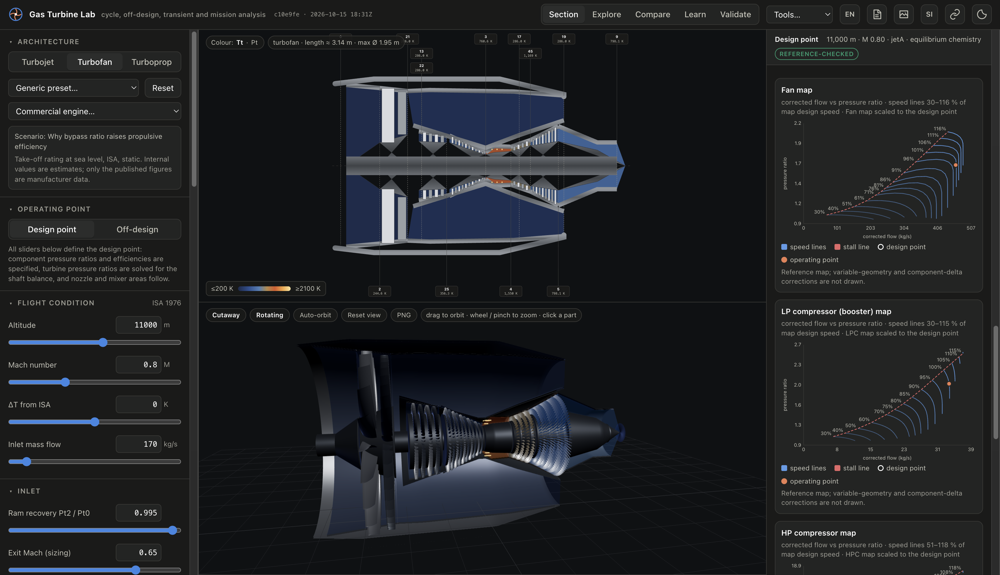

# Gas Turbine Lab

[](https://gas-turbine-lab.fly.dev/)

A gas-turbine engine laboratory that runs entirely in the browser. It is an installable progressive web app with no server-side code: the static bundle is served by nginx on Fly.io and every calculation, including the solvers, runs on the device.

**Live:** [gas-turbine-lab.fly.dev](https://gas-turbine-lab.fly.dev/)

Build a **turbojet** (optionally afterburning), a **turbofan** (two or three spools, separate or mixed flow, direct-drive or geared fan) or a **free-turbine turboprop**, solve its design point, then run the fixed engine **off-design**, through **transients** with a control system, over a **mission**, through **optimisation** and **uncertainty** studies, and check **emissions and noise**. Results appear on an engine cross-section, a 3D cutaway, station tables, cycle diagrams, component maps and parametric sweeps. Everything can be compared, saved, shared as a link, exported to CSV or PNG, or written up as an engineering report.

The documented design/off-design reference cases agree with NASA's pyCycle to the tolerances reported in [docs/validation.md](docs/validation.md).

## Documentation

| Document | Contents |
|---|---|
| [docs/user-guide.md](docs/user-guide.md) | How to use each view, inputs and outputs, layouts, units, sharing |
| [docs/methods.md](docs/methods.md) | The physics: gas model, components, design and off-design solvers, transients, control, thermal, secondary air, mission, optimisation, estimates |
| [docs/validation.md](docs/validation.md) | pyCycle reference cases, tolerances, how to regenerate the references, known differences |
| [docs/development.md](docs/development.md) | Code layout, running and testing, CI, deployment, how to add an architecture, a map, a preset or a scenario |
| [docs/public-release.md](docs/public-release.md) | Publication readiness, licensing boundaries and remaining release checks |
| [CHANGELOG.md](CHANGELOG.md) | What was added, in order |

## Capabilities at a glance

**Cycle model.** NASA CEA polynomials with Gibbs-minimisation equilibrium chemistry (frozen mode available); Jet-A, SAF, hydrogen and methane; humid air; ISA-1976 atmosphere. Inlet, compressors with bleeds, combustor, turbines with cooling streams, afterburner, constant-area mixer, convergent and convergent–divergent nozzles, gearboxes, actuator-disc propeller. Shaft balances per spool. Statics and flow areas at every station.

**Off-design.** Component maps (pyCycle's generic NPSS-style maps, uploaded maps, parametric, stage-stacked or geometry-based maps) scaled through the design point; Newton solution for flows, speeds, bypass ratio, R-lines and turbine pressure ratios at fixed geometry; throttle by T4, fuel flow, spool speed or thrust; variable geometry, bleeds and a secondary air system; sub-idle map extensions.

**Dynamics.** Spool transients with inertias, fuel schedules and ratio-unit limiters, start-up with a starter, an unlit burner until light-off and an explicit starter-only regime, a FADEC with N1/N2/thrust loops and actuator schedules, heat soak and tip-clearance effects with contact detection. Only converged gas-path solutions drive the dynamics; an unsolvable step stops the run and says so.

**Design studies.** Mission analysis against an aircraft polar with ratings, Nelder–Mead optimisation with constraints, Monte Carlo uncertainty, weight and size estimates, installed performance, emissions (P3–T3 and ICAO LTO with CAEP/8 limits) and noise (jet and fan).

**Catalogue.** 59 named engine models calibrated to nominal take-off ratings. Internal parameters and generic maps are estimates; the [source ledger](reference/catalogue-provenance.json) distinguishes checked fields from unresolved values and rating-condition differences.

**Interface.** Desktop, tablet and phone layouts; SI or US units; English or French; dark or light theme; guided teaching scenarios.

## Quick start

Use Node.js 22.12 or newer (Node 22 is used by CI and Docker). Python is optional and used only to regenerate reference data locally.

```bash
npm ci
npx playwright install chromium
npm run dev        # http://localhost:5173
npm test           # unit and validation tests (vitest)
npm run test:e2e   # layout and feature tests in a headless browser (Playwright)
npm run build      # production bundle with service worker in dist/
```

## Fly.io deployment

The live app is hosted at [gas-turbine-lab.fly.dev](https://gas-turbine-lab.fly.dev/). Deployment is manual; pushing to GitHub runs CI but does not deploy the app.

[fly.toml](fly.toml) targets the existing `gas-turbine-lab` app in Toronto (`yyz`), using one shared CPU and 256 MB of memory. The machine stops when idle and starts on incoming requests, so the first visit after an idle period can take longer. HTTPS is enforced, and nginx listens internally on port 8080.

The multi-stage [Dockerfile](Dockerfile) builds the static PWA with Node.js 22, then copies it into an nginx 1.27 image. Fly.io only serves static files: solvers and analyses run in the browser, including Web Workers. Python is used locally to regenerate reference data and is not included in the deployed app. No database or persistent volume is required.

### Deploy an update

Install and authenticate the Fly.io CLI with access to the existing app, and the GitHub CLI with access to this repository. Run these commands from the repository root.

1. Commit and push the changes. Check that `git status --short` is empty, then find the CI run for that exact commit:

   ```bash
   gh run list --workflow CI --commit "$(git rev-parse HEAD)"
   gh run view RUN_ID
   gh run watch RUN_ID --exit-status
   ```

   Replace `RUN_ID` with the matching run ID. Proceed only after CI completes successfully. Local test passes do not replace this check; CI also rejects browser tests that only pass on retry.

2. Deploy the checked-out commit:

   ```bash
   fly deploy --build-arg GIT_SHA="$(git rev-parse --short HEAD)"
   ```

   The build argument supplies the commit shown alongside the build time in the app header. It is required because `.git` is excluded from the Docker build context. This command updates the existing app named in `fly.toml`; use a separately provisioned app and configuration for your own deployment.

3. Confirm Fly.io reports a successful deployment, then open the live app in a desktop browser and check that the header shows the deployed commit. Check that the HTML loads its current hashed JavaScript bundle and that `/sw.js` precaches that same bundle.

The [nginx configuration](deploy/nginx.conf) caches hashed assets for a year and requests revalidation for HTML, the service worker and the manifest. An installed PWA can initially display its previous cached build; reconnect or reload and verify the header version before judging the deployment. The app checks for updates on startup, when returning to the tab and after reconnection, while retaining offline use.

See [docs/development.md](docs/development.md#deployment) for the development and release workflow.

## Status and limits

Agreement with pyCycle covers the listed reference cases, not every architecture/configuration or an engine-test envelope. Everything else is physically based but not validated against an external reference: transients, control, thermal, secondary air, mission, optimisation and uncertainty use the validated cycle but their own models and defaults. Weight, emissions, noise, a temperature-only life proxy and installation drag are correlation estimates and are labelled as such in the interface. The generic maps are not the catalogue engines' real maps, so off-design trends for a named engine are representative rather than engine-specific.

## Licence and acknowledgements

Original project code and documentation are licensed under the [MIT License](LICENSE). Third-party material retains its own terms: in particular, the pyCycle-derived thermodynamic and map data remain Apache-2.0. See [THIRD_PARTY_NOTICES.md](THIRD_PARTY_NOTICES.md). Production builds include `/LICENSE.txt` and `/THIRD_PARTY_NOTICES.txt`.

The repository remains private pending the checks in [docs/public-release.md](docs/public-release.md). MIT licensing does not change GitHub visibility. `private: true` in `package.json` prevents accidental npm publication; it is independent of GitHub repository visibility.

For development contributions, see [CONTRIBUTING.md](CONTRIBUTING.md); for sensitive reports, see [SECURITY.md](SECURITY.md). Manufacturer names identify the modeled products and do not imply affiliation or endorsement.
